# 🎬 IMDB Sentiment Analysis with Deep Learning

A deep-learning practical project that classifies IMDB movie reviews as **positive** or **negative** using neural-network baselines and recurrent architectures.

> **Dataset:** IMDB movie reviews (50K dataset)  
> **Main notebook:** `Pr_5.ipynb` (keep the notebook and dataset alongside this README when running the project)  
> **Framework:** Python, TensorFlow/Keras, NumPy, pandas, scikit-learn, Matplotlib

---

## 📌 Project Overview

The project explores how neural networks learn sentiment from sequences of words. It includes an ANN baseline and recurrent models, along with experiments about sequence length, gradient flow, model complexity, and error analysis.

### Models covered

- **ANN baseline** — a non-recurrent baseline for comparison.
- **SimpleRNN** — processes tokens sequentially using a recurrent hidden state.
- **LSTM** — uses gated cell-state updates to help preserve longer-range information.
- **Stacked LSTM** — stacks recurrent layers to learn more complex representations.
- **GRU** — uses update and reset gates with a more compact gating design than LSTM.

🎥 **Video:** [`Explanation Video`](https://drive.google.com/file/d/1dyl48J4srtE-wqF76ArJWylJC0tDCqZO/view?usp=sharing)

## 🎯 Objectives

- Prepare and inspect review text and sentiment labels.
- Convert reviews to token sequences and padded inputs.
- Implement and evaluate ANN, SimpleRNN, LSTM, Stacked LSTM, and GRU.
- Study vanishing/exploding gradients and gradient clipping.
- Compare model accuracy, precision, recall, F1-score, ROC-AUC, parameter count, and training behaviour.
- Inspect confusion matrices, ROC curves, review lengths, and misclassified examples.
- Provide a reusable `predict_sentiment(text)` inference function.

## 🧰 Requirements

Suggested environment:

- Python 3.11
- TensorFlow / Keras
- NumPy
- pandas
- scikit-learn
- Matplotlib
- Jupyter Notebook or VS Code

Install the main packages:

```bash
pip install tensorflow numpy pandas scikit-learn matplotlib jupyter
```

## ▶️ How to Run

1. Place `Pr_5.ipynb`, the IMDB dataset CSV, `README.md`, and the `plots/` directory in your project folder.
2. Create and activate a Python virtual environment if required by your course.
3. Install the dependencies.
4. Open `Pr_5.ipynb` in Jupyter Notebook or VS Code.
5. Update the dataset path in the notebook if necessary.
6. Run the notebook cells **in order**, from data loading through final evaluation.
7. Check the generated figures and `final_model_comparison.csv`.

**Important:** The notebook expects the IMDB dataset file to be available locally. Do not commit a very large dataset to a public repository unless its license and your course instructions permit it.

## 📊 Final Model Comparison

The following table is based on the supplied `final_model_comparison.csv`. Blank measurements were not available in the CSV and are not estimated.

| Model        |   Parameters |   Time per Epoch (s) |   Epochs Trained |   Test Accuracy |   Precision |   Recall |     F1 |   ROC-AUC |
|:-------------|-------------:|---------------------:|-----------------:|----------------:|------------:|---------:|-------:|----------:|
| ANN          |    1,528,449 |                  nan |              nan |          0.8755 |      0.8979 |   0.8483 | 0.8724 |    0.9445 |
| SimpleRNN    |      326,273 |                  nan |              nan |          0.8323 |      0.8577 |   0.7983 | 0.8269 |    0.902  |
| LSTM         |      344,897 |                  nan |              nan |          0.8877 |      0.8853 |   0.8917 | 0.8885 |    0.9525 |
| Stacked LSTM |      357,281 |                  nan |              nan |          0.8822 |      0.8546 |   0.9222 | 0.8871 |    0.95   |
| GRU          |      338,881 |                  nan |              nan |          0.8876 |      0.9074 |   0.8642 | 0.8853 |    0.9535 |

### Result highlights

- The supplied ROC plot reports the highest AUC for **GRU (approximately 0.953)**, with LSTM close behind.
- The saved comparison table shows the LSTM's test accuracy around **0.8878** and the Stacked LSTM around **0.8822**; compare all metrics together rather than selecting a model by AUC alone.
- The SimpleRNN ROC-AUC is lower than the gated recurrent models in the supplied results.
- Training-time values are missing from the supplied comparison CSV, so this README does not infer speed rankings.

## 🖼️ Plots and Visual Results

All supplied plot images are included in the `plots/` folder and embedded below. If a plot does not render on a hosting platform, open the image directly from that folder.

### 1. Training stability and gradient behaviour

#### SimpleRNN: gradient clipping comparison
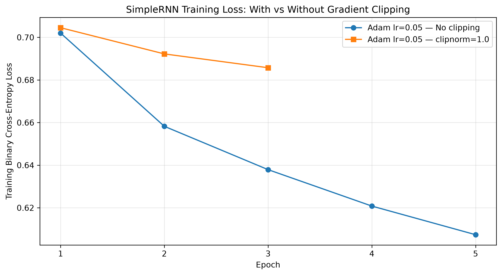

#### SimpleRNN: training and validation curves


#### Gradient flow comparison: SimpleRNN vs LSTM vs GRU
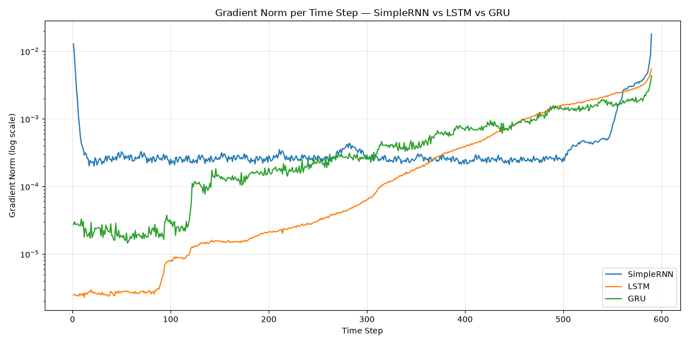

### 2. Recurrent model learning curves

#### LSTM training curves
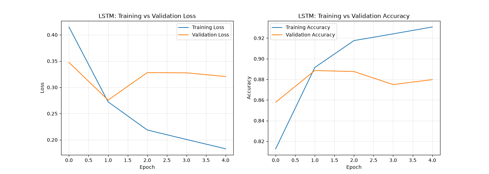

#### Stacked LSTM loss and accuracy
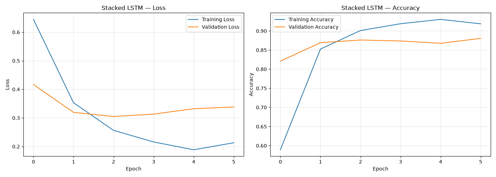

#### GRU training and validation curves
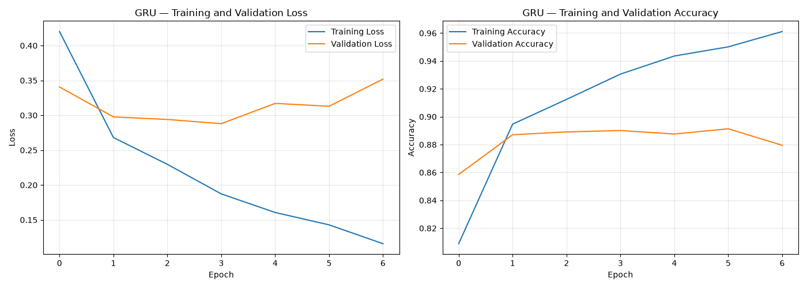

#### ANN loss and accuracy
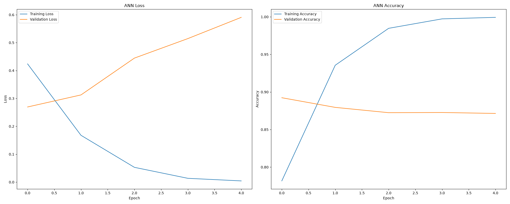

### 3. Classification evaluation

#### Combined ROC curves
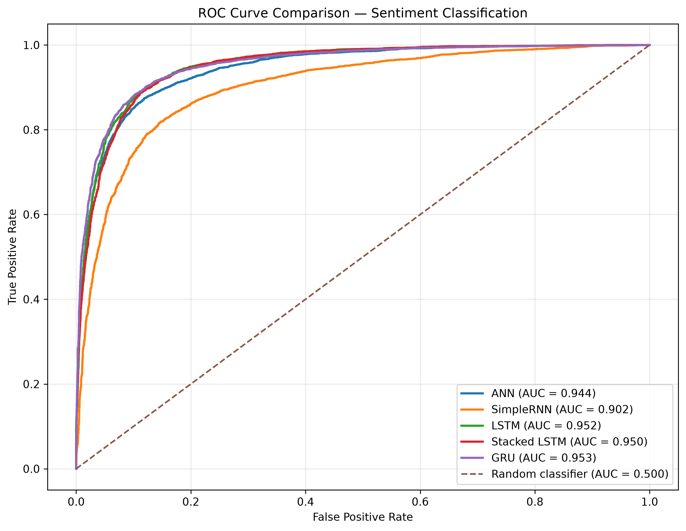

#### SimpleRNN confusion matrix
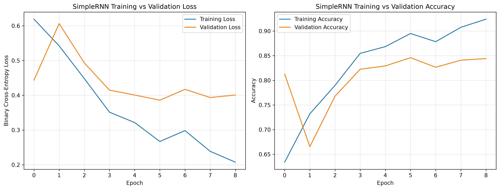

#### LSTM confusion matrix
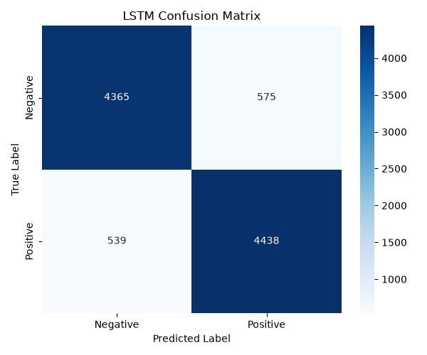

#### Stacked LSTM confusion matrix
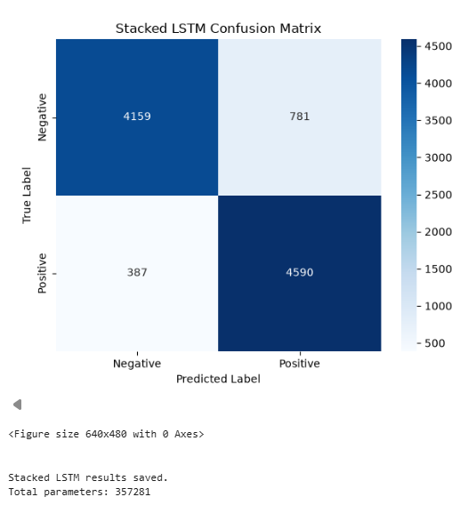

#### GRU confusion matrix


### 4. Sequence length and review analysis

#### SimpleRNN test accuracy vs sequence length
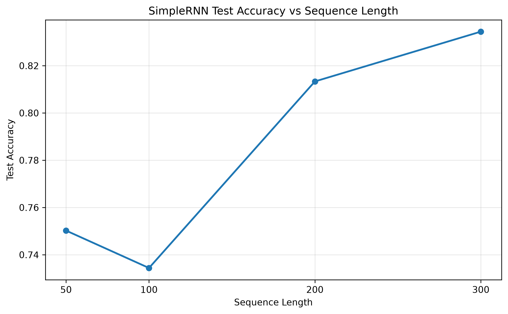

#### Review word-count distribution
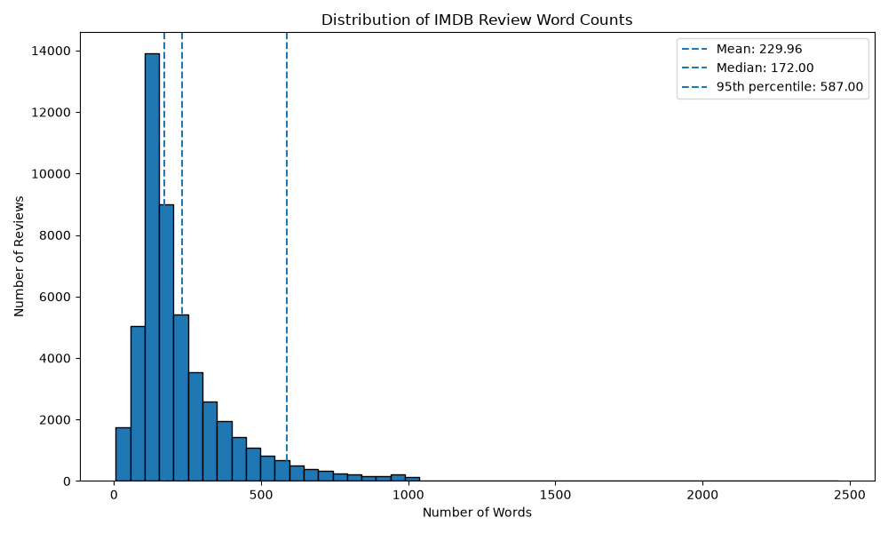

#### Review word counts by sentiment
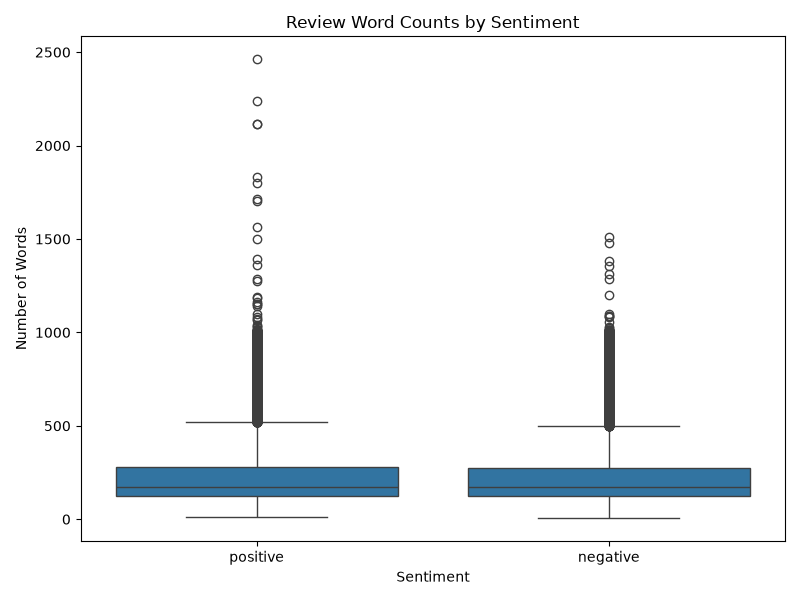

### 5. Recurrent-state visualisations

#### Manual RNN hidden-state heatmap
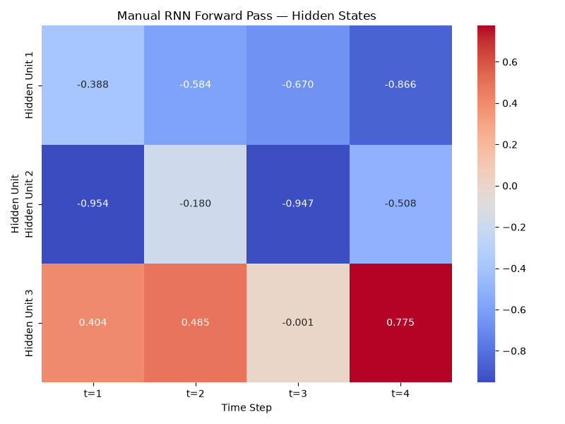

#### GRU hidden-state update
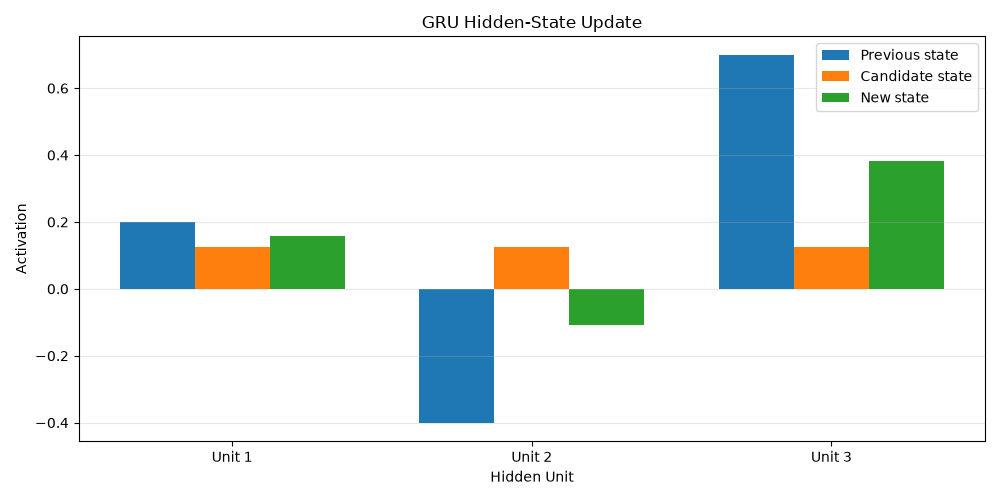

## 🧠 Key Takeaways

- Gated recurrent cells such as LSTM and GRU can preserve useful information over longer sequences more effectively than a basic SimpleRNN in many settings.
- Gradient clipping limits large gradients; it is a stabilisation technique and does not by itself solve vanishing gradients.
- More hidden units or stacked layers increase model capacity and parameter count, but do not guarantee better generalisation.
- Confusion matrices and ROC-AUC complement accuracy by showing different aspects of classification performance.
- Review length and ambiguous language can affect classification difficulty.

## 📁 Project Structure

```text
PR5_README_PACKAGE/
├── README.md
├── final_model_comparison.csv
└── plots/
    ├── simple_rnn_gradient_clipping_comparison.png
    ├── simple_rnn_training_curves.png
    ├── combined_roc_curves.png
    ├── gradient_flow.png
    ├── lstm_training_curves.png
    ├── gru_curves.png
    └── ... other supplied plots
```

## 🚀 Future Improvements

- Save and restore the best model checkpoints for reproducible inference.
- Use a consistent train/validation/test split and document the random seed.
- Add a `requirements.txt` with exact package versions from the working environment.
- Evaluate all models on the same held-out test set and report all metrics consistently.
- Add a small CLI or web interface around `predict_sentiment(text)`.

## 👤 Credits

Prepared as a Deep Learning practical project using the IMDB review dataset and TensorFlow/Keras.

---

**Note:** Results shown here reflect the supplied output files and may vary with random seeds, preprocessing, package versions, and training configuration.
